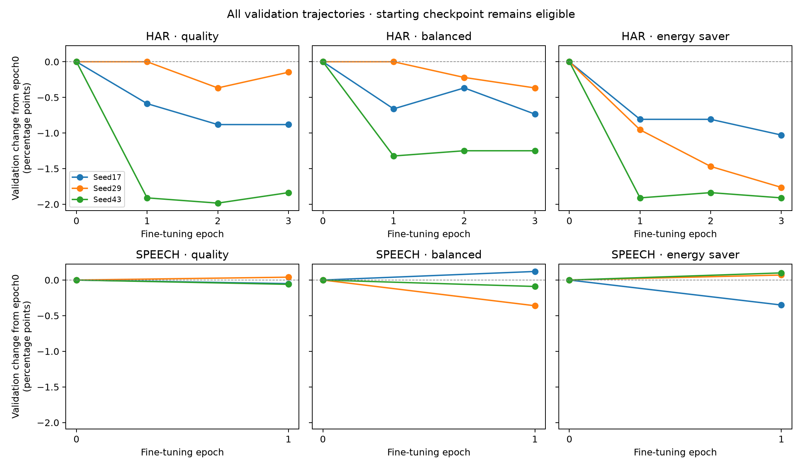
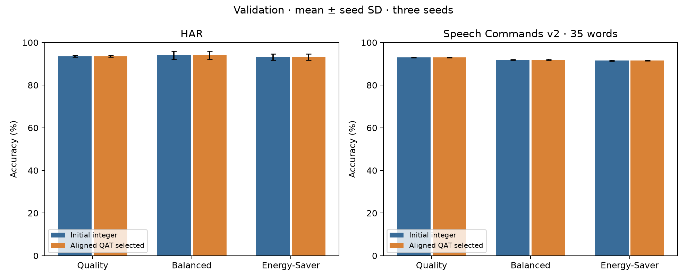
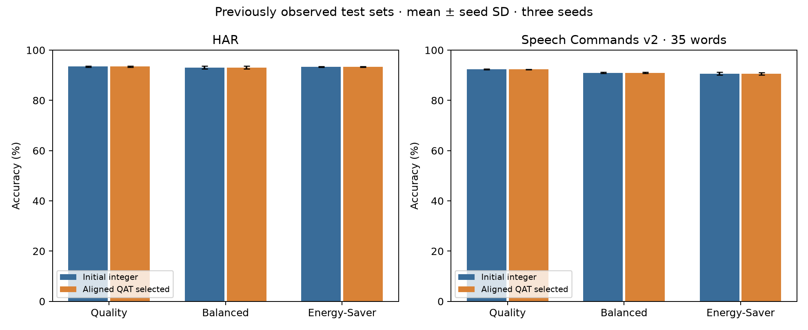

# Aligned numerical model and fine tuning results

This study implements a trainable PyTorch forward pass with the existing integer deployment contract and verifies it against the separately implemented NumPy integer reference. All checkpoint selection uses validation data. Test results below are subsequent evaluations on the test sets already observed in commit 0633422; they are not new untouched-test evidence.

## What changed

The original dynamic fake-quantized training model remains unchanged. The new `AlignedEncoder` uses fixed training-calibrated input, linear and QKV scales; exported per-channel weight scales and Q24 multipliers; integer bias and gamma quantization; signed24/Q12 residual state; the same rsqrt, exponential and PWL tables; tiled online attention rounding; integer summary/pooling divisions; and identical stable group ranking. No new calibration is fitted during fine-tuning.

Forward values use independent CPU PyTorch arithmetic. A custom autograd operation returns the exact forward value and passes gradients through a differentiable surrogate. This avoids cancellation roundoff from the usual x+(q−x).detach() expression. Backward operators use floating RMSNorm, PWL and materialized attention plus identity straight-through quantization and the retained-feature scorer surrogate. These gradients are approximations; no claim of an exact derivative through discrete arithmetic is made.

The PyTorch implementation does not call NumPy/golden inference or arithmetic. For speed, bounded integer products use floating GEMM only where integer exactness is provable: INT8 products with reduction at most256 fit all FP32 partial sums within 2^22, below2^24; signed24 QK products over at most32 elements fit within 2^51, below FP64’s2^53; Q20 probabilities times signed24 values over tiles of at most8 fit within 2^46. Range/shape checks and highest FP32 precision are required. Other arithmetic uses INT64 containers. This is an exact numerical emulator, not an integer-only PyTorch runtime or a hardware performance model. The NumPy reference remains integer-only.

## Controlling template requirements

The Word plan takes priority. Section14.7 requires QAT, a full encoder numerical model, full-test prediction comparison, deterministic vectors and per-layer errors. Section14.8/G2 additionally requires Balanced HAR quality, hardware feasibility and engine/attention verification. This study checks exact integer logits, all recorded intermediate points, selected groups and summaries rather than accepting similar accuracy. It does not freeze the hardware architecture or declare all of G2 passed.

## First divergence before training

The initial diagnosis uses 32 evenly spaced validation examples per workload/mode/seed, 576 examples across 18 settings. On original inputs, the legacy model first exceeds one Q12 unit of real error at the embedding output on 567 examples and at the first RMSNorm on 9. With the same quantized/dequantized input as the integer model, all 192 Quality examples first exceed the threshold at the first RMSNorm; all 384 adaptive-mode examples first exceed it at embedding. Host quantization therefore does not explain the complete discrepancy. The threshold is diagnostic, not a correctness tolerance or attribution of later prediction changes to one operator.

The aligned implementation has maximum exact intermediate error 0 integer LSBs and 0 changed group choices across the initial diagnosis. Full endpoint and intermediate comparisons after fine-tuning appear below. This agreement follows a new, explicit training-forward contract; it does not retroactively make the original dynamic fake-quantized forward equivalent.

## Fine tuning protocol

Each mode starts from its own existing mode checkpoint, not downloaded pretrained weights. Seeds17,29,43 are retained. HAR uses three complete training epochs and speech one complete epoch, batch128, CPU, one PyTorch thread per worker, deterministic algorithms, AdamW learning rate3e−5, weight decay0.01, cosine decay, gradient clipping1 and primary classification cross-entropy. No auxiliary-head loss is added. These are limited-budget fine-tuning runs rather than convergence studies. They are not training-budget-matched to the original FP32 control.

The original epoch 0 checkpoint is eligible for selection. Strictly higher validation accuracy replaces it; ties retain the earlier checkpoint. This prevents forcing a worse checkpoint merely to report new training. Selected epoch 0 means fine-tuning ran but the starting model won validation selection. Selected validation accuracy is nondecreasing by construction, so its gains alone are not unbiased evidence of better generalization. Every epoch’s loss and validation metrics are retained. The epoch 0 full-validation predictions are checked against the previously saved integer predictions before optimization starts.

| Checkpoint | Epochs run | Selected epoch | Initial validation % | Selected validation % |
| --- | --- | --- | --- | --- |
| har_quality_seed17 | 3 | 0 | 93.167 | 93.167 |
| har_quality_seed29 | 3 | 0 | 93.975 | 93.975 |
| har_quality_seed43 | 3 | 0 | 93.461 | 93.461 |
| har_balanced_seed17 | 3 | 0 | 91.918 | 91.918 |
| har_balanced_seed29 | 3 | 0 | 95.812 | 95.812 |
| har_balanced_seed43 | 3 | 0 | 94.342 | 94.342 |
| har_energy_saver_seed17 | 3 | 0 | 91.844 | 91.844 |
| har_energy_saver_seed29 | 3 | 0 | 94.783 | 94.783 |
| har_energy_saver_seed43 | 3 | 0 | 93.020 | 93.020 |
| speech_quality_seed17 | 1 | 0 | 93.127 | 93.127 |
| speech_quality_seed29 | 1 | 1 | 93.187 | 93.227 |
| speech_quality_seed43 | 1 | 0 | 92.816 | 92.816 |
| speech_balanced_seed17 | 1 | 1 | 91.985 | 92.105 |
| speech_balanced_seed29 | 1 | 0 | 92.045 | 92.045 |
| speech_balanced_seed43 | 1 | 0 | 91.754 | 91.754 |
| speech_energy_saver_seed17 | 1 | 0 | 91.784 | 91.784 |
| speech_energy_saver_seed29 | 1 | 1 | 91.454 | 91.524 |
| speech_energy_saver_seed43 | 1 | 1 | 91.293 | 91.394 |



14 of 18 settings retain epoch 0 after the declared fine-tuning budget. This is a negative fine-tuning outcome for those settings, not a claim that their weights improved. `epochs.csv` records every training loss and validation result, including unselected epochs. Independent updated-parameter tests additionally take optimizer steps, export changed constants and compare all traces for W8, W4 and early-exit modes, so export verification is not limited to unchanged starting weights.

## Validation accuracy

Mean ± sample SD across three seeds. Paired deltas describe changes from the same mode’s original integer checkpoint; they are not significance tests.

| Workload | Mode | Initial integer accuracy % | Aligned selected accuracy % | Paired change points | Macro F1 |
| --- | --- | --- | --- | --- | --- |
| har | balanced | 94.024 ± 1.967 | 94.024 ± 1.967 | +0.000 ± 0.000 | 0.9403 ± 0.0216 |
| har | energy_saver | 93.216 ± 1.479 | 93.216 ± 1.479 | +0.000 ± 0.000 | 0.9308 ± 0.0169 |
| har | quality | 93.534 ± 0.409 | 93.534 ± 0.409 | +0.000 ± 0.000 | 0.9342 ± 0.0054 |
| speech | balanced | 91.928 ± 0.153 | 91.968 ± 0.188 | +0.040 ± 0.069 | 0.9128 ± 0.0029 |
| speech | energy_saver | 91.511 ± 0.250 | 91.567 ± 0.199 | +0.057 ± 0.051 | 0.9071 ± 0.0031 |
| speech | quality | 93.043 ± 0.199 | 93.057 ± 0.214 | +0.013 ± 0.023 | 0.9230 ± 0.0018 |



## Accuracy on previously observed test sets

Mean ± sample SD across three seeds. Paired deltas describe changes from the same mode’s original integer checkpoint; they are not significance tests.

| Workload | Mode | Initial integer accuracy % | Aligned selected accuracy % | Paired change points | Macro F1 |
| --- | --- | --- | --- | --- | --- |
| har | balanced | 93.055 ± 0.553 | 93.055 ± 0.553 | +0.000 ± 0.000 | 0.9310 ± 0.0051 |
| har | energy_saver | 93.360 ± 0.207 | 93.360 ± 0.207 | +0.000 ± 0.000 | 0.9340 ± 0.0019 |
| har | quality | 93.474 ± 0.255 | 93.474 ± 0.255 | +0.000 ± 0.000 | 0.9349 ± 0.0024 |
| speech | balanced | 90.986 ± 0.238 | 90.998 ± 0.247 | +0.012 ± 0.021 | 0.9007 ± 0.0034 |
| speech | energy_saver | 90.616 ± 0.575 | 90.586 ± 0.518 | -0.030 ± 0.139 | 0.8957 ± 0.0053 |
| speech | quality | 92.379 ± 0.153 | 92.328 ± 0.103 | -0.051 ± 0.089 | 0.9143 ± 0.0014 |



## Independent full model equivalence

| Partition | Workload | Mode | Compared examples across seeds | Max integer LSB error | Changed predictions | Changed group choices |
| --- | --- | --- | --- | --- | --- | --- |
| test | har | balanced | 8841 | 0 | 0 | 0 |
| validation | har | balanced | 4083 | 0 | 0 | 0 |
| test | har | energy_saver | 8841 | 0 | 0 | 0 |
| validation | har | energy_saver | 4083 | 0 | 0 | 0 |
| test | har | quality | 8841 | 0 | 0 | 0 |
| validation | har | quality | 4083 | 0 | 0 | 0 |
| test | speech | balanced | 33015 | 0 | 0 | 0 |
| validation | speech | balanced | 29943 | 0 | 0 | 0 |
| test | speech | energy_saver | 33015 | 0 | 0 | 0 |
| validation | speech | energy_saver | 29943 | 0 | 0 | 0 |
| test | speech | quality | 33015 | 0 | 0 | 0 |
| validation | speech | quality | 29943 | 0 | 0 | 0 |

These denominators repeat the same partition across training seeds. Every NumPy trace point is compared exactly against the aligned model, including linear INT8 inputs/accumulators, Q/K/V, normalized states, attention, residuals, PWL outputs, scorer sums, selected groups, compacted summaries, pooling and logits. Missing points, shape mismatches, any nonzero error, or changed logits stop the pipeline and save the first divergence. Aligned evaluation uses batches64 against per-example NumPy inference, also testing fixed-scale batch independence. Full validation must pass for all 18 settings before the post-training test settings are recorded and subsequent test evaluation starts.

Exact agreement validates the software numerical contract and export implementation. It does not prove robustness to sensor noise, good task accuracy, physical feasibility, timing closure, board equivalence or energy savings. Group identity agreement is between implementations on the same input, not stability under input perturbations. New robustness and timing measurements were not performed in this alignment study.

## Interpretation

The main result is numerical implementation agreement under an explicit aligned training-forward contract. The original dynamic fake-quantized forward remains a different model. All nine HAR settings retain their starting checkpoints, so this fine-tuning budget produces no selected HAR weight or accuracy improvement. Speech selects four updated checkpoints on validation; small selected validation gains alone do not establish improved generalization.

Speech quality changes mean accuracy on the previously observed test set by -0.051 percentage points versus its starting integer model (paired seed SD 0.089).
Speech balanced changes mean accuracy on the previously observed test set by +0.012 percentage points versus its starting integer model (paired seed SD 0.021).
Speech energy saver changes mean accuracy on the previously observed test set by -0.030 percentage points versus its starting integer model (paired seed SD 0.139).

Architecture, precision formats, retained-token counts and exit depths are unchanged, so the earlier structural MAC counts still apply. This is not a new speed or energy result. The study establishes exact software agreement for independent modes; shared-weight alignment and all hardware parts of G2 remain outstanding.

## Artifacts and reproduction

- `results/alignment_study/training_plan.json`: source, data, template and initial-model hashes plus fixed training/evaluation protocol.
- `initial_diagnosis.json`: legacy first-divergence and aligned intermediate comparisons.
- `runs/<name>/`: initial/selected validation, complete epoch history and selected checkpoint.
- `exports/<name>/`: integer weights/constants under unchanged calibration and format settings.
- `validation/<name>/` and `test/<name>/`: all logits/labels, exact per-point errors, saturation counts and first-example golden vectors.
- `summary.csv`, `per_seed.csv`, `per_class.csv`, `training.csv`: machine-readable results.
- `post_training_test_freeze.json`: selected exports and full-validation evidence fixed before subsequent test evaluation.
- `phases.json`: ordered phase timestamps. No RTL, synthesis or board evidence is implied.

```sh
.venv/bin/python -m native.build
.venv/bin/python -m results.run_alignment_study
.venv/bin/python -m results.alignment_report
.venv/bin/python -m results.alignment_audit
.venv/bin/python -m pytest -q
```

For aligned PyTorch inference, load `AlignedEncoder("results/alignment_study/exports/<name>").eval()` and supply a batch of preprocessed FP32 windows. The module quantizes the host input with the recorded fixed scale. Use `IntegerEncoder` for the integer-only path with prequantized INT8 inputs. Loading shadow parameters into the original `model.network.Encoder` instead invokes the old dynamic fake-quantized contract and is not the aligned model.

Matching completed runs are reused after provenance checks. An incomplete training directory stops for explicit recovery rather than silently restarting. Reproduction requires the recorded prepared-data hashes; cross-platform frontend or compression differences can prevent byte-identical regeneration and must be recorded as a separate study, not accepted by overwriting this plan. Original study sources, data, checkpoints, exports and frozen plan remain unchanged. Future experiments must retain the disclosure that test results have already been seen.
