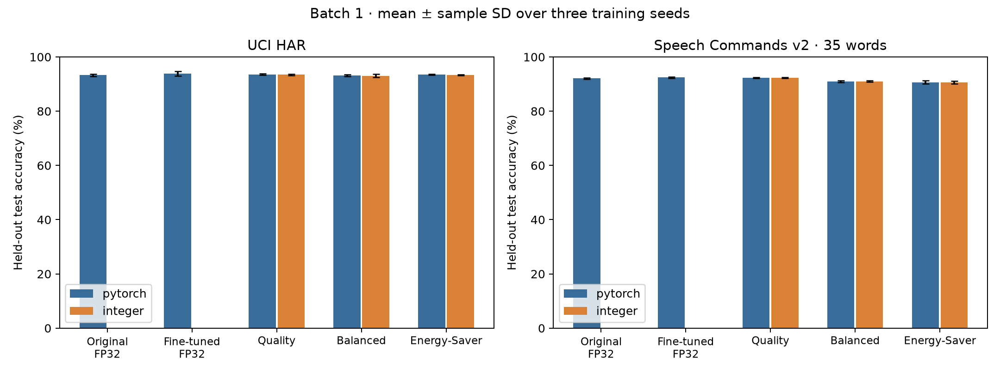
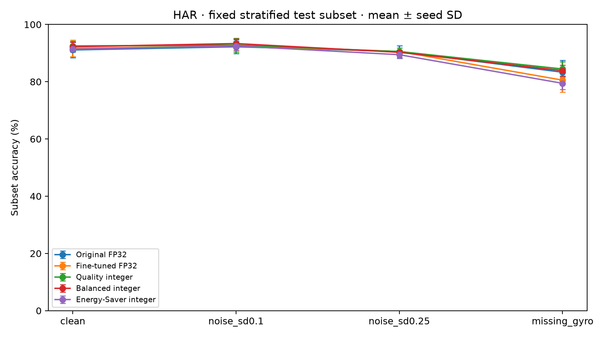
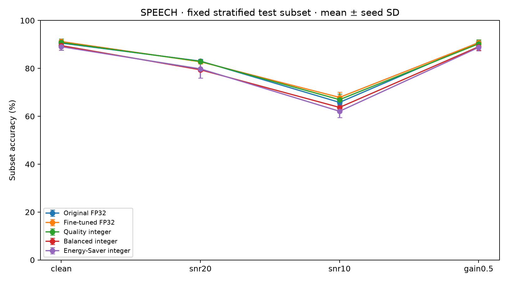

# Python held out evaluation results

These are measured classification results from Python on unseen official test partitions. No model parameters, scales, modes, or preprocessing were fitted to test results. Hardware timing, energy and RTL equivalence have not been measured.

The frozen plan contains 54 checkpoint/mode evaluations, including 27 integer comparisons. HAR has 2,947 test windows; Speech Commands has 11,005 test clips. Every configuration has seeds 17, 29 and 43. Values below are mean ± sample SD across seeds, not confidence intervals. Each seed sees the same test examples.

## Main classification results

| Workload | Configuration | PyTorch accuracy % | Integer accuracy % | Integer macro F1 |
| --- | --- | --- | --- | --- |
| har | fp32 | 93.259 ± 0.363 | — | — |
| har | fp32_control | 93.881 ± 0.829 | — | — |
| har | quality | 93.541 ± 0.276 | 93.474 ± 0.255 | 0.9349 ± 0.0024 |
| har | balanced | 93.236 ± 0.326 | 93.055 ± 0.553 | 0.9310 ± 0.0051 |
| har | energy_saver | 93.541 ± 0.174 | 93.360 ± 0.207 | 0.9340 ± 0.0019 |
| har | joint_quality | 93.496 ± 0.600 | 93.360 ± 0.604 | 0.9340 ± 0.0064 |
| har | joint_balanced | 93.123 ± 0.982 | 92.919 ± 1.026 | 0.9294 ± 0.0109 |
| har | joint_energy_saver | 92.659 ± 0.475 | 92.444 ± 0.645 | 0.9246 ± 0.0066 |
| speech | fp32 | 92.101 ± 0.274 | — | — |
| speech | fp32_control | 92.440 ± 0.244 | — | — |
| speech | quality | 92.340 ± 0.144 | 92.379 ± 0.153 | 0.9149 ± 0.0021 |
| speech | balanced | 90.986 ± 0.343 | 90.986 ± 0.238 | 0.9008 ± 0.0035 |
| speech | energy_saver | 90.638 ± 0.614 | 90.616 ± 0.575 | 0.8958 ± 0.0063 |



Original FP32 checkpoints had 30 training epochs. The FP32 control and quantized modes received the same additional fine-tuning budget within each workload: HAR 30 epochs, speech 5 epochs. Shared HAR modes received 30 total joint fine-tuning epochs. Comparisons against the original baseline therefore include additional training. The FP32 control is the closer training-budget comparison. Independent mode checkpoints do not constitute one runtime-switchable weight set; the joint HAR family does.

## HAR ablations on held out data

These comparisons use batch1 PyTorch inference and independent training runs with paired initialization seeds. Positive changes favor the destination. They do not establish statistical significance or isolate all training effects. The equal-retained-group comparison adds summary tokens; the matched20-token comparison controls total processed token count.

| From | To | Mean paired accuracy change points | Sample SD points |
| --- | --- | --- | --- |
| fp32_control | quality | -0.339 | 0.789 |
| quality | dense_w4 | +0.396 | 0.713 |
| dense_w4 | drop_keep6 | -0.724 | 0.838 |
| drop_keep6 | balanced | +0.023 | 0.340 |
| drop_keep4 | rts_keep4 | +0.023 | 0.813 |
| drop_keep5_matched20 | rts_keep4 | +0.238 | 0.791 |
| rts_keep4 | energy_saver | +0.147 | 0.733 |

## Class specific errors

The table identifies the lowest mean per-class recall and the most frequent off-diagonal confusion after pooling counts across seeds. Pooled confusion describes repeated predictions on the same test set, not additional unique subjects or speakers. Complete precision, recall, F1 and support are in `per_class.csv`.

| Workload | Mode | Implementation | Lowest recall class and mean recall % | Most frequent confusion | Count across seeds |
| --- | --- | --- | --- | --- | --- |
| har | fp32_control | pytorch | SITTING: 84.39 | SITTING → STANDING | 226 |
| har | quality | integer | SITTING: 80.31 | SITTING → STANDING | 283 |
| har | balanced | integer | SITTING: 81.60 | SITTING → STANDING | 266 |
| har | energy_saver | integer | SITTING: 83.03 | SITTING → STANDING | 243 |
| speech | fp32_control | pytorch | forward: 75.27 | forward → four | 78 |
| speech | quality | integer | forward: 75.91 | forward → four | 72 |
| speech | balanced | integer | forward: 75.27 | forward → four | 75 |
| speech | energy_saver | integer | forward: 67.53 | forward → four | 112 |

## Numerical agreement on the full test sets

| Workload | Mode | Changed vs fake / compared examples | Agreement % | Max absolute logit error | Changed group selections |
| --- | --- | --- | --- | --- | --- |
| har | quality | 118 / 8841 | 98.665 | 8.94433 | 0 |
| har | balanced | 100 / 8841 | 98.869 | 9.47440 | 3424 |
| har | energy_saver | 132 / 8841 | 98.507 | 6.16414 | 3939 |
| har | joint_quality | 110 / 8841 | 98.756 | 3.99579 | 0 |
| har | joint_balanced | 117 / 8841 | 98.677 | 4.39475 | 3489 |
| har | joint_energy_saver | 129 / 8841 | 98.541 | 4.56977 | 3773 |
| speech | quality | 364 / 33015 | 98.897 | 2.72493 | 0 |
| speech | balanced | 408 / 33015 | 98.764 | 11.60467 | 498 |
| speech | energy_saver | 427 / 33015 | 98.707 | 7.57853 | 2660 |

These counts repeat the test set across seeds; the denominator is not a set of independent unique examples. The template’s G2 condition is not declared passed. The template also requires hardware feasibility and unit verification, which are outside this software evaluation.

Each integer evaluation stores input clipping and per-operation saturation counts, maximum intermediate error on semantically aligned token rows, the first golden vector and the worst final-logit-error vector. `same_checkpoint_unquantized` is a precision counterfactual with the same fine-tuned weights and token/depth mode; it is not the separately trained FP32 baseline. Both comparisons are retained in CSV/JSON.

Group-selection changes are a distinct numerical limitation: independent HAR Balanced/Energy-Saver change retained group identities on about 39–45 percent of comparisons even though final-prediction agreement is about 98.5–98.9 percent. A subsequent exploratory validation-only diagnosis finds few exact cutoff ties and small HAR score margins relative to score perturbations. It changes no frozen inference settings. See [numerical findings](python_numerical_findings.md) for all three seeds, score margins, tie counts and the distinction between execution-path stability and classification agreement.

| Workload | Mode | Input values clipped / input values | Internal values saturated |
| --- | --- | --- | --- |
| har | balanced | 0 / 10184832 | 1 |
| har | energy_saver | 0 / 10184832 | 0 |
| har | joint_balanced | 0 / 10184832 | 33 |
| har | joint_energy_saver | 0 / 10184832 | 3 |
| har | joint_quality | 0 / 10184832 | 0 |
| har | quality | 0 / 10184832 | 0 |
| speech | balanced | 0 / 84518400 | 28 |
| speech | energy_saver | 0 / 84518400 | 14 |
| speech | quality | 0 / 84518400 | 1 |

Checked accumulator and intermediate overflow raises an exception; all completed test runs finished without such an exception. Saturation counts above include intentional INT8 operand and signed24 state clamping. The individual operation counts remain in each run’s metrics JSON; they are not all accumulator overflows.

## Robustness

Robustness uses 120 HAR windows (20/class) and 350 speech clips (10/word), sampled once with RNG seed 20261023 and shared across configurations and training seeds. It is exploratory and is not a replacement for full-test accuracy. Noise and missing-channel conditions were fixed before test evaluation. No recovery training was performed.

| Workload | Mode | Implementation | Condition | Accuracy % | Paired change from clean points |
| --- | --- | --- | --- | --- | --- |
| har | balanced | integer | missing_gyro | 83.89 ± 1.92 | -8.33 |
| har | balanced | integer | noise_sd0.1 | 93.33 ± 1.67 | +1.11 |
| har | balanced | integer | noise_sd0.25 | 90.28 ± 0.48 | -1.94 |
| har | energy_saver | integer | missing_gyro | 79.44 ± 2.10 | -11.94 |
| har | energy_saver | integer | noise_sd0.1 | 92.50 ± 1.67 | +1.11 |
| har | energy_saver | integer | noise_sd0.25 | 89.44 ± 1.27 | -1.94 |
| har | fp32 | pytorch | missing_gyro | 83.33 ± 4.17 | -7.78 |
| har | fp32 | pytorch | noise_sd0.1 | 92.22 ± 2.41 | +1.11 |
| har | fp32 | pytorch | noise_sd0.25 | 90.56 ± 2.10 | -0.56 |
| har | fp32_control | pytorch | missing_gyro | 80.56 ± 4.19 | -11.11 |
| har | fp32_control | pytorch | noise_sd0.1 | 92.50 ± 1.44 | +0.83 |
| har | fp32_control | pytorch | noise_sd0.25 | 90.56 ± 0.48 | -1.11 |
| har | quality | integer | missing_gyro | 84.44 ± 2.55 | -8.06 |
| har | quality | integer | noise_sd0.1 | 92.78 ± 2.41 | +0.28 |
| har | quality | integer | noise_sd0.25 | 90.56 ± 1.27 | -1.94 |
| speech | balanced | integer | gain0.5 | 89.05 ± 1.41 | -0.48 |
| speech | balanced | integer | snr10 | 63.71 ± 1.14 | -25.81 |
| speech | balanced | integer | snr20 | 79.43 ± 0.49 | -10.10 |
| speech | energy_saver | integer | gain0.5 | 88.76 ± 1.41 | -0.29 |
| speech | energy_saver | integer | snr10 | 62.10 ± 2.56 | -26.95 |
| speech | energy_saver | integer | snr20 | 79.81 ± 3.86 | -9.24 |
| speech | fp32 | pytorch | gain0.5 | 90.86 ± 0.49 | +0.29 |
| speech | fp32 | pytorch | snr10 | 65.81 ± 1.81 | -24.76 |
| speech | fp32 | pytorch | snr20 | 83.05 ± 0.82 | -7.52 |
| speech | fp32_control | pytorch | gain0.5 | 90.76 ± 1.15 | -0.48 |
| speech | fp32_control | pytorch | snr10 | 67.90 ± 2.16 | -23.33 |
| speech | fp32_control | pytorch | snr20 | 82.76 ± 0.92 | -8.48 |
| speech | quality | integer | gain0.5 | 90.29 ± 1.59 | -0.57 |
| speech | quality | integer | snr10 | 66.95 ± 2.29 | -23.90 |
| speech | quality | integer | snr20 | 82.95 ± 0.66 | -7.90 |

HAR noise is expressed in training-standardized feature units. Missing gyro means replacing all three normalized body-gyro channels with zero, representing their training means. Speech perturbations operate on padded one-second waveforms, before the unchanged log-mel frontend and training normalization. White noise uses SNR20/10 dB before PCM clipping and rounding; clipping counts and clean frontend reproduction error are recorded in the subset manifest. Gain0.5 is a waveform amplitude change. Real-world noise, device shift and missing-data detectors have not been evaluated.





## Python timing and structural computation

Timing machine: Apple M3 Pro, macOS-14.4-arm64-arm-64bit; CPU batch1 with one PyTorch thread, 20 warmups and 200 timed calls cycling through the first32 training inputs. Each forward call is synchronous. Loading, preprocessing and input quantization are excluded. Integer execution includes Python checks and trace recording plus the native INT8 dot kernel. Raw per-call times are saved. There is one timing session and CPU frequency/thermal state is uncontrolled. These are software timings, not FPGA or Cortex-A53 baselines or energy measurements.

| Workload | Mode | PyTorch median range across seeds ms | PyTorch p95 range ms | Integer median range ms | Integer p95 range ms |
| --- | --- | --- | --- | --- | --- |
| har | fp32 | 0.578–0.667 | 0.753–0.883 | — | — |
| har | fp32_control | 0.580–0.648 | 0.674–0.878 | — | — |
| har | quality | 1.550–1.667 | 1.985–2.131 | 12.096–14.065 | 12.673–24.157 |
| har | balanced | 1.715–1.780 | 1.882–2.052 | 10.883–11.185 | 11.938–12.350 |
| har | energy_saver | 0.897–0.924 | 0.930–0.950 | 5.227–5.390 | 5.343–5.908 |
| speech | fp32 | 0.572–0.673 | 0.584–0.782 | — | — |
| speech | fp32_control | 0.572–0.655 | 0.580–0.676 | — | — |
| speech | quality | 1.452–1.693 | 1.467–1.738 | 11.566–11.770 | 11.802–12.414 |
| speech | balanced | 1.514–1.745 | 1.540–1.811 | 10.900–11.053 | 11.004–11.649 |
| speech | energy_saver | 0.814–1.022 | 0.821–1.168 | 5.178–5.240 | 5.242–5.313 |

Token lengths and executed depths are fixed by the mode: Quality32 tokens/4 layers; Balanced32 tokens in block1 then26/4 layers; Energy-Saver32 tokens in block1 then20/2 layers. Token identities depend on input, but token count and depth do not. `structure.csv` gives exact structural MAC counts and an encoder-matrix-only weight payload for all four layers. This excludes biases, scales, positions, other weights, banking and buffers; compressed NPZ and checkpoint sizes are file sizes, not hardware memory footprints. Sorting, nonlinear functions and data movement are excluded from MAC counts.

| Workload | Mode | Executed MACs | MAC reduction vs Quality % | Encoder matrix weight payload bytes |
| --- | --- | --- | --- | --- |
| har | quality | 17,974,016 | 0.00 | 524,288 |
| har | balanced | 15,352,576 | 14.58 | 262,144 |
| har | energy_saver | 7,334,656 | 59.19 | 262,144 |
| speech | quality | 18,157,952 | 0.00 | 524,288 |
| speech | balanced | 15,536,512 | 14.44 | 262,144 |
| speech | energy_saver | 7,518,592 | 58.59 | 262,144 |

Small improvements under weak noise on the HAR subset are descriptive observations on a small fixed sample, not evidence of a statistically established robustness benefit. White-noise speech and missing-gyro HAR results demonstrate limitations of the current models; no noise-aware retraining or missing-channel recovery is claimed.

## Artifacts and reproduction

- `results/python_study/evaluation_plan.json`: timestamp, template/checkpoint/export/data/source hashes and predetermined protocol.
- `summary.csv`, `per_seed.csv`, `per_class.csv`, `disagreements.csv`, `structure.csv`: machine-readable full-test results.
- `test/<name>/`: metrics, full logits/labels, predictions, numerical traces and checksums.
- `robustness/`: exact subset indices, perturbed features, predictions and PCM clipping metadata.
- `timing.json` and `timing.csv`: raw timing samples, boundaries and environment.
- `figures/`: accuracy, per-class confusion and robustness plots.
- `paper/python_numerical_findings.md`: controlling template requirements and validation discrepancy investigation.

From the repository root, using the existing prepared data and saved artifacts:

```sh
.venv/bin/python -m model.python_study run --workers 3
.venv/bin/python -m results.python_robustness
# Wait until inference workers have finished before timing
.venv/bin/python -m results.python_timing
.venv/bin/python -m results.python_report
.venv/bin/python -m results.python_audit
.venv/bin/python -m pytest -q
```

The runner verifies frozen source, test data, checkpoints and exports, and reuses completed matching results. The initial freeze command is deliberately not repeatable over an existing plan. Future model changes require a new study and disclosure that these test results have already been seen. Hardware, submission readiness and G2 remain outstanding.
