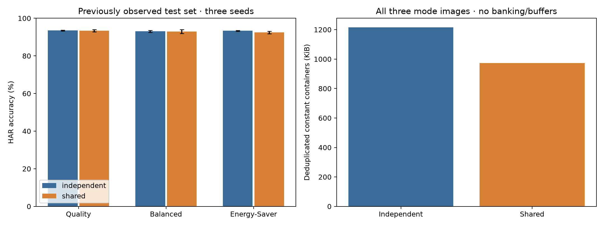
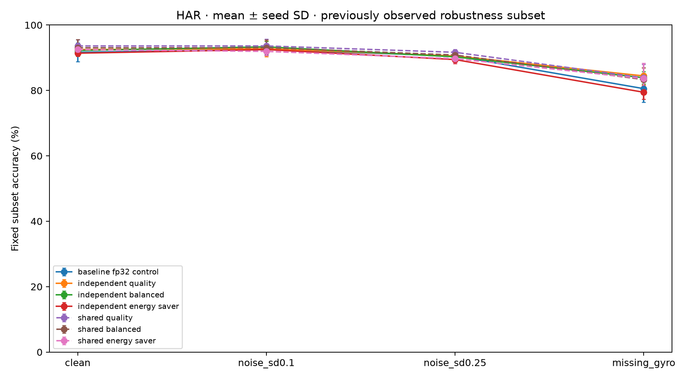
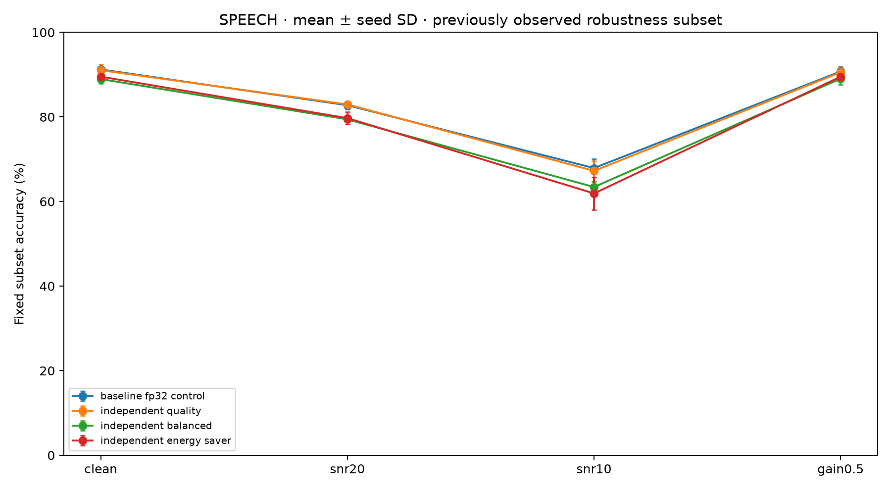

# Frozen software release with shared HAR modes and robustness

This release verifies the existing shared-weight HAR family under aligned arithmetic, repeats the predefined robustness study on all final aligned models, and publishes an immutable model catalog. No new training, recalibration, mode selection or hyperparameter search is performed. Test sets and robustness subsets were previously observed; these are subsequent software comparisons, not new untouched-test evidence.

## Scope and controlling instructions

The controlling Word plan remains authoritative. Its full-model numerical comparisons, three-seed quality reporting and finite mode requirements motivate this release. A software release freeze does not approve G2 hardware feasibility, interfaces or board equivalence. The independent aligned models remain the default for continuity; the shared HAR family is an additional published option, not a winner selected on these new test comparisons.

There are27 aligned settings:18 independent (two workloads × three modes × three seeds) and9 shared HAR settings (one checkpoint per seed, three modes). `SharedAlignedEncoder` aliases the same actual PyTorch network object across its mode branches. Pointer identity, parameter deduplication, deterministic mode switching and rejection of unrelated checkpoints are unit-tested. Calibration and quantized constant images are still mode-specific. `shared_state_dict()` serializes the common parameters once; the general PyTorch state dictionary contains alias paths and should not be used to infer physical sharing.

## Accuracy and exact numerical comparisons

Mean ± sample SD across seeds17,29,43. Independent results reuse the audited final alignment study; shared results run every validation/test input through the shared adapter and separate NumPy reference. Every reference trace point, integer logit, retained-group identity and summary is checked with zero tolerance. Full shared validation must pass before the subsequent shared test comparisons.

| Workload | Family | Mode | Validation accuracy % | Subsequent test accuracy % | Test macro F1 |
| --- | --- | --- | --- | --- | --- |
| har | independent | quality | 93.534 ± 0.409 | 93.474 ± 0.255 | 0.9349 ± 0.0024 |
| har | independent | balanced | 94.024 ± 1.967 | 93.055 ± 0.553 | 0.9310 ± 0.0051 |
| har | independent | energy_saver | 93.216 ± 1.479 | 93.360 ± 0.207 | 0.9340 ± 0.0019 |
| har | shared | quality | 94.146 ± 1.508 | 93.360 ± 0.604 | 0.9340 ± 0.0064 |
| har | shared | balanced | 94.269 ± 1.256 | 92.919 ± 1.026 | 0.9294 ± 0.0109 |
| har | shared | energy_saver | 91.967 ± 1.339 | 92.444 ± 0.645 | 0.9246 ± 0.0066 |
| speech | independent | quality | 93.057 ± 0.214 | 92.328 ± 0.103 | 0.9143 ± 0.0014 |
| speech | independent | balanced | 91.968 ± 0.188 | 90.998 ± 0.247 | 0.9007 ± 0.0034 |
| speech | independent | energy_saver | 91.567 ± 0.199 | 90.586 ± 0.518 | 0.8957 ± 0.0053 |

The shared family is the previously trained joint HAR checkpoint: no additional epochs are added. This experiment aligns the forward contract and verifies the existing weights; it does not claim new accuracy gains from retraining. The independent models retain their earlier validation-selected checkpoints. The catalog publishes all three seeds rather than selecting a favorable test seed.

## Storage tradeoff

| HAR family | Seed | Unique checkpoints | FP32 parameter bytes | All constant containers bytes | Deduplicated constant containers bytes |
| --- | --- | --- | --- | --- | --- |
| independent | 17 | 3 | 6,474,396 | 1,328,624 | 1,246,544 |
| independent | 29 | 3 | 6,474,396 | 1,327,280 | 1,245,200 |
| independent | 43 | 3 | 6,474,396 | 1,327,280 | 1,245,200 |
| shared | 17 | 1 | 2,158,132 | 1,327,280 | 997,056 |
| shared | 29 | 1 | 2,158,132 | 1,327,280 | 997,056 |
| shared | 43 | 1 | 2,158,132 | 1,327,280 | 997,056 |

FP32 parameter bytes describe the shadow checkpoint tensors, not FPGA memory. Constant containers use packed signed W4/W8 weights and signed64 containers for remaining constants, matching the earlier payload convention. Deduplication requires byte-identical blobs with identical encoding. Sharing one FP32 checkpoint does not eliminate distinct W8/W4 images, scales, biases or tables. Compressed checkpoint file sizes are recorded separately in `storage.csv`. Metadata, activations, buffer duplication, ports, physical banking and routing overhead are excluded; no physical fit or energy result follows from this accounting.



## Final model robustness

All27 settings are evaluated on the exact saved, previously observed subsets:120 HAR windows (20/class) and350 speech clips (10/word). The same inputs are used for all seeds and families. HAR conditions are clean, Gaussian noise SD0.1/0.25 in training-standardized units, and all three normalized gyro channels set to zero. Speech conditions are clean, waveform white noise at20/10dB SNR, and waveform amplitude gain0.5 before the unchanged log-mel frontend and train-only normalization. The original PCM-clipping and frontend-reconstruction metadata is retained unchanged. The FP32 control results are reused from their audited predictions on these identical subsets.

Both aligned and NumPy implementations are run on every perturbed input, checking all intermediate points and exact logits. Input clipping and runtime saturation counts are retained per condition. This checks agreement under perturbations; it does not make predictions invariant to noise. No noise-aware fine-tuning or recovery policy is introduced.

| Workload | Family | Mode | Condition | Accuracy % | Paired change from clean points |
| --- | --- | --- | --- | --- | --- |
| har | baseline | fp32_control | missing_gyro | 80.56 ± 4.19 | -11.11 |
| har | baseline | fp32_control | noise_sd0.1 | 92.50 ± 1.44 | +0.83 |
| har | baseline | fp32_control | noise_sd0.25 | 90.56 ± 0.48 | -1.11 |
| har | independent | balanced | missing_gyro | 83.89 ± 1.92 | -8.33 |
| har | independent | balanced | noise_sd0.1 | 93.33 ± 1.67 | +1.11 |
| har | independent | balanced | noise_sd0.25 | 90.28 ± 0.48 | -1.94 |
| har | independent | energy_saver | missing_gyro | 79.44 ± 2.10 | -11.94 |
| har | independent | energy_saver | noise_sd0.1 | 92.50 ± 1.67 | +1.11 |
| har | independent | energy_saver | noise_sd0.25 | 89.44 ± 1.27 | -1.94 |
| har | independent | quality | missing_gyro | 84.44 ± 2.55 | -8.06 |
| har | independent | quality | noise_sd0.1 | 92.78 ± 2.41 | +0.28 |
| har | independent | quality | noise_sd0.25 | 90.56 ± 1.27 | -1.94 |
| har | shared | balanced | missing_gyro | 83.33 ± 3.63 | -9.72 |
| har | shared | balanced | noise_sd0.1 | 93.06 ± 2.41 | -0.00 |
| har | shared | balanced | noise_sd0.25 | 90.83 ± 0.83 | -2.22 |
| har | shared | energy_saver | missing_gyro | 83.61 ± 4.74 | -8.89 |
| har | shared | energy_saver | noise_sd0.1 | 91.94 ± 1.27 | -0.56 |
| har | shared | energy_saver | noise_sd0.25 | 89.72 ± 1.27 | -2.78 |
| har | shared | quality | missing_gyro | 83.89 ± 4.11 | -9.72 |
| har | shared | quality | noise_sd0.1 | 93.61 ± 2.10 | -0.00 |
| har | shared | quality | noise_sd0.25 | 91.67 ± 0.83 | -1.94 |
| speech | baseline | fp32_control | gain0.5 | 90.76 ± 1.15 | -0.48 |
| speech | baseline | fp32_control | snr10 | 67.90 ± 2.16 | -23.33 |
| speech | baseline | fp32_control | snr20 | 82.76 ± 0.92 | -8.48 |
| speech | independent | balanced | gain0.5 | 89.05 ± 1.41 | +0.10 |
| speech | independent | balanced | snr10 | 63.43 ± 1.25 | -25.52 |
| speech | independent | balanced | snr20 | 79.43 ± 0.49 | -9.52 |
| speech | independent | energy_saver | gain0.5 | 89.52 ± 0.59 | +0.00 |
| speech | independent | energy_saver | snr10 | 61.90 ± 3.84 | -27.62 |
| speech | independent | energy_saver | snr20 | 79.71 ± 1.43 | -9.81 |
| speech | independent | quality | gain0.5 | 90.57 ± 1.25 | -0.48 |
| speech | independent | quality | snr10 | 67.24 ± 2.38 | -23.81 |
| speech | independent | quality | snr20 | 82.95 ± 0.66 | -8.10 |





These are small, class-balanced exploratory subsets, not full-test accuracy or independent draws across seeds. Mean ± seed SD is not a confidence interval or significance test. Per-class metrics, exact subset indices, logits, clipping counts and full trace comparison counts are retained. Real device shift and environmental noise are not established by these synthetic perturbations.

## Release contents and reproduction

`catalog.json` fixes all27 model settings, loaders, paths and checkpoint/export checksums. `plan.json` records the controlling template, sources, data, existing selected artifacts and robustness input hashes before evaluation. `accuracy.csv`, `per_seed.csv`, `per_class.csv`, `robustness_summary.csv`, `structure.csv` and `storage.csv` are machine-readable tables. Shared full-partition results and all robustness predictions live beside these tables. `audit.json` verifies the evidence. Earlier studies are preserved.

After installing the pinned dependencies, preparing byte-identical data and building the native kernel, one command verifies/reuses the numerical results and regenerates the final release tables, plots, catalog and audit:

```sh
.venv/bin/python -m results.software_release run
```

The existing plan is intentionally immutable. Completed artifacts are reused only with matching provenance. Different prepared-data hashes, changed inference sources or altered checkpoints require a separately disclosed study rather than overwriting this release. CPU inference uses `AlignedEncoder` for independent exports or `SharedAlignedEncoder` with all three joint exports for a seed; the integer reference remains a separate implementation. The legacy dynamic encoder is not interchangeable with the aligned loaders.

## Remaining paper requirements

This is a software release. Runtime MAC structure is unchanged and recorded in `structure.csv`; no new hardware speed, energy, Cortex-A53 baseline, synthesis, timing closure or board-equivalence result is claimed. Physical banking, hardware G2, RTL, board measurements, fair prior-hardware comparison and independent manuscript review remain outstanding.
