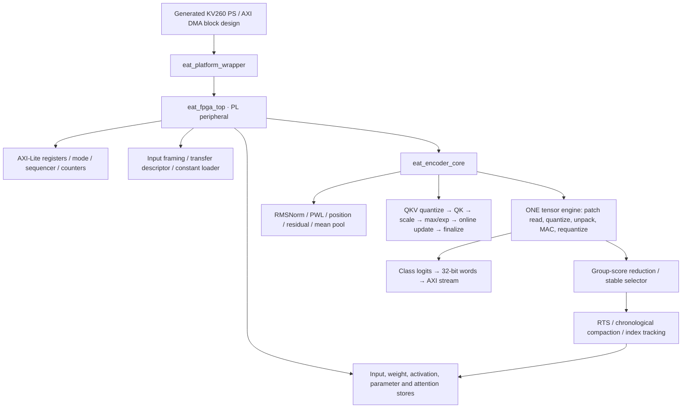

# VHDL scope and implementation outline

The controlling Word plan is the authority: Sections 7.1–7.5, 8, 14.2 and 14.7–14.8.
This is the Week 1 interface/skeleton deliverable, authorized by the RTL scoping
request. It does not approve interfaces, resource sizing or full G1/G2 completion.
The original outline had 52 skeletons. The current design has 53 entities: 38
implemented and 15 remaining skeletons. A shared vector specialization helper
was added. Exact block/subsystem regressions pass; the connected encoder and
host/platform integration remain incomplete. See `IMPLEMENTATION_STATUS.md`.

## In scope for Paper 1 Lite

- One reused four-block encoder, d = 128, four heads, FFN = 256 and group size 4.
- Both host-preprocessed HAR and Speech Commands;32 input tokens per export.
- W8A8 and W4A8, per-channel multipliers, fixed activation/QKV exponents.
- Q12 wider state, exact candidate RMSNorm/PWL/online-attention rounding.
- Dense W8 Quality baseline and Balanced/Energy-Saver paths with 26/20 post-gate tokens.
- Stable group selection, one RTS summary per dropped group, early exit after block 2.
- On-chip parameters/buffers, AXI-Lite control, AXI DMA streams and event counters.
- Reset/flush, ready/valid stalls, masks/tails, trace/vector and error verification.

The software release's independent and shared parameter families use the same
arithmetic datapath. The loaded image/identity changes; no second encoder engine
is needed. Deploy a chosen workload/seed/family, not all 27 research settings at once.

## Planned service hierarchy

This diagram is logical dataflow, not instantiated wiring. One tensor engine is
shared by every linear operation; the scorer consumes its results.

The full encoder does not instantiate this graph yet. Tensor, vector and gate
subsystems now instantiate their implemented children. Explicit shared-resource arbitration,
operand/metadata FIFOs, buffer lifetimes and physical bank mapping are review work.
Do not interpret a dependency edge in the inventory as another physical engine.

## Complete project VHDL surface

Packages establish the type/configuration/register vocabulary. The configuration
package is generated from the numerical contract and RTL proposal; the remaining
entity files are editable VHDL, one entity per file. Tables below identify every
proposed block. Stage numbers refer to the verification/implementation milestones.

| Package | Purpose |
| --- | --- |
| [eat_config_pkg](pkg/eat_config_pkg.vhd) | Generated numerical widths, dimensions, lanes and draft bus sizes |
| [eat_types_pkg](pkg/eat_types_pkg.vhd) | Signed formats, beats, descriptors, memory requests, contexts and events |
| [eat_registers_pkg](pkg/eat_registers_pkg.vhd) | Proposed host offsets and command bits; no PS base address |
| [eat_vector_engine](vector/eat_vector_engine.vhd) | Row-buffered specialization shared by RMSNorm, position and PWL wrappers |

## Common modules

| Entity | Role | Stage |
| --- | --- | --- |
| [eat_reset_sync](common/eat_reset_sync.vhd) | Convert platform active-low asynchronous reset to core reset; no other CDC is assumed. | 1 |
| [eat_rv_fifo](common/eat_rv_fifo.vhd) | Elastic buffering and flush; no data accepted by the stub. | 1 |
| [eat_stream_register](common/eat_stream_register.vhd) | One elastic state beat, stable under backpressure. | 1 |

## Arithmetic modules

| Entity | Role | Stage |
| --- | --- | --- |
| [eat_round_shift](arithmetic/eat_round_shift.vhd) | Nearest-even signed right shift or checked left shift; explicit output saturation. | 1 |
| [eat_round_divide](arithmetic/eat_round_divide.vhd) | Nearest-even signed numerator/positive denominator division; no truncating divide. | 1 |
| [eat_reduction_tree](arithmetic/eat_reduction_tree.vhd) | Masked wide sum with overflow check; used by norm/attention/vector reductions. | 1 |
| [eat_leading_one](arithmetic/eat_leading_one.vhd) | Leading-one normalization for nonnegative variance; explicit zero flag. | 1 |
| [eat_exp_lut](arithmetic/eat_exp_lut.vhd) | Rounded Q8 address into 4097-entry Q20 exp table; zero outside supported range. | 3 |
| [eat_rsqrt_lut](arithmetic/eat_rsqrt_lut.vhd) | Read 1024 Q30 mantissa coefficients; exponent/parity correction belongs to RMSNorm. | 2 |
| [eat_pwl_silu](arithmetic/eat_pwl_silu.vhd) | Nine rounded knots; preserve exact tails and interpolation rounding. | 2 |

## Memory modules

| Entity | Role | Stage |
| --- | --- | --- |
| [eat_memory_arbiter](memory/eat_memory_arbiter.vhd) | Tagged logical memory requests; physical banking/ports remain a design decision. | 2 |
| [eat_input_buffer](memory/eat_input_buffer.vhd) | Raw signed INT8 host window, separate from Q12 activation storage. | 2 |
| [eat_weight_buffer_banked](memory/eat_weight_buffer_banked.vhd) | On-chip packed W4/W8 parameter banks; no automatic DSP packing assumption. | 2 |
| [eat_activation_buffer_pingpong](memory/eat_activation_buffer_pingpong.vhd) | Q12 activations and residual ping-pong storage; tags and bank swaps on legal boundaries. | 2 |
| [eat_attention_state_buffer](memory/eat_attention_state_buffer.vhd) | Per-head/query row maxima, normalizers and weighted-value state. | 2 |
| [eat_token_index_buffer](memory/eat_token_index_buffer.vhd) | Original token/group indices and summary provenance for compaction. | 2 |
| [eat_parameter_store](memory/eat_parameter_store.vhd) | Typed view of biases, multipliers, gamma, shifts, positions and nonlinear tables. | 2 |
| [eat_constant_loader](memory/eat_constant_loader.vhd) | Range-check 64-bit containers, populate banks, attach host-verified identity; no SHA engine. | 2 |

## Tensor modules

| Entity | Role | Stage |
| --- | --- | --- |
| [eat_address_generator](tensor/eat_address_generator.vhd) | Generate actual row/column/reduction addresses and lane masks, including 26-token tails. | 2 |
| [eat_patch_reader](tensor/eat_patch_reader.vhd) | Read 32 patch rows (HAR K36, speech K80), adapting host scale to embedding input scale. | 2 |
| [eat_activation_quantizer](tensor/eat_activation_quantizer.vhd) | Q12 state to fixed-scale INT8; nearest-even shift and counted saturation. | 2 |
| [eat_weight_unpack](tensor/eat_weight_unpack.vhd) | Low nibble first INT4 sign extension or INT8 lanes; reject other precisions. | 2 |
| [eat_mac_lane](tensor/eat_mac_lane.vhd) | One enabled INT8 product and checked 40-bit K accumulation; W4 is sign-extended. | 2 |
| [eat_mac_array](tensor/eat_mac_array.vhd) | Candidate 8x8 PE array with row/column broadcast and disabled padded lanes. | 2 |
| [eat_requantizer](tensor/eat_requantizer.vhd) | Add bias in accumulator domain, check 40 bits, multiply Q24, round and saturate state. | 2 |
| [eat_tensor_engine](tensor/eat_tensor_engine.vhd) | Reusable embedding/QKV/projection/FFN/scorer/classifier matrix core. | 2 |

## Vector modules

| Entity | Role | Stage |
| --- | --- | --- |
| [eat_position_add](vector/eat_position_add.vhd) | Saturating Q12 learned-position addition before block one. | 2 |
| [eat_residual_add](vector/eat_residual_add.vhd) | Rendezvous matching token/feature/context beats; saturating signed 24 addition. | 2 |
| [eat_mean_pool](vector/eat_mean_pool.vhd) | Sum actual 20/26/32 token rows, then nearest-even division, independently per feature. | 2 |
| [eat_rmsnorm](vector/eat_rmsnorm.vhd) | Two-pass row norm: mean square, epsilon 168, rsqrt LUT/parity, Q14 gamma and saturation. | 2 |

## Attention modules

| Entity | Role | Stage |
| --- | --- | --- |
| [eat_qkv_quantizer](attention/eat_qkv_quantizer.vhd) | Split QKV and quantize Q/K/V independently to INT8 with recorded exponents. | 3 |
| [eat_qk_tile_engine](attention/eat_qk_tile_engine.vhd) | INT8 QK dot, restore both exponents to checked Q24; no fused scaling-rounding shortcut. | 3 |
| [eat_score_scale](attention/eat_score_scale.vhd) | Q24 to Q12 rounding followed by Q20 1/sqrt(head-width) multiplier and rounding. | 3 |
| [eat_rowmax_exp](attention/eat_rowmax_exp.vhd) | Mask padded keys, compute tile maximum, alpha and per-key Q20 exponentials. | 3 |
| [eat_running_normalizer](attention/eat_running_normalizer.vhd) | Rescale previous Q20 denominator and add valid exponentials; checked signed 32. | 3 |
| [eat_av_tile_engine](attention/eat_av_tile_engine.vhd) | Q20 coefficient times INT8 V with restored exponent; round each tile before state update. | 3 |
| [eat_attention_finalize](attention/eat_attention_finalize.vhd) | Round weighted-value numerator times 2^20 divided by final normalizer to Q12. | 3 |
| [eat_streaming_attention_engine](attention/eat_streaming_attention_engine.vhd) | Orchestrate head/query/key tiles and online state; never allocate a full score matrix. | 3 |

## Tokens modules

| Entity | Role | Stage |
| --- | --- | --- |
| [eat_group_scorer](tokens/eat_group_scorer.vhd) | Consume shared tensor OP_SCORE results, store token scores and sum exact groups of four. | 4 |
| [eat_group_selector](tokens/eat_group_selector.vhd) | Stable top-k group selection; earlier group wins ties; no scores rounded to a mean. | 4 |
| [eat_rts_summary](tokens/eat_rts_summary.vhd) | Per dropped group: abs(Q12 score)+4096 weights, checked signed 53 numerator, nearest-even divide. | 4 |
| [eat_token_compactor](tokens/eat_token_compactor.vhd) | Chronological retained groups/summary emission with original-index tracking and actual count. | 4 |

## Control modules

| Entity | Role | Stage |
| --- | --- | --- |
| [eat_mode_controller](control/eat_mode_controller.vhd) | Latch mode/bank/identity only at idle boundary; reject busy/invalid starts. | 2 |
| [eat_encoder_sequencer](control/eat_encoder_sequencer.vhd) | Issue embedding/position, pre-norm attention/FFN/residuals, block-one gate, final norm/pool/head. | 3 |
| [eat_performance_counters](control/eat_performance_counters.vhd) | Per-inference active/stall/saturation/traffic counters with atomic completion snapshot. | 2 |

## Host modules

| Entity | Role | Stage |
| --- | --- | --- |
| [eat_axi_ctrl_regs](host/eat_axi_ctrl_regs.vhd) | AXI4-Lite register front end; independent AW/W buffering, identity and snapshots. | 2 |
| [eat_dma_descriptor_engine](host/eat_dma_descriptor_engine.vhd) | PL transfer counts/routing for PS AXI DMA; not a custom DDR AXI master. | 2 |
| [eat_axi_stream_input](host/eat_axi_stream_input.vhd) | Unpack 128-bit TKEEP/TLAST framed input/constant transfers into byte streams. | 2 |
| [eat_axi_stream_output](host/eat_axi_stream_output.vhd) | Pack class-order signed 24 logits into sign-extended 32-bit words; TLAST on final word. | 2 |

## Top modules

| Entity | Role | Stage |
| --- | --- | --- |
| [eat_encoder_core](top/eat_encoder_core.vhd) | Logical core integration boundary; child interconnect is not wired in this skeleton. | 3 |
| [eat_fpga_top](top/eat_fpga_top.vhd) | Single-clock PL peripheral: control, transfer/storage and encoder/output boundaries; not connected yet. | 5 |

## Platform modules

| Entity | Role | Stage |
| --- | --- | --- |
| [eat_platform_wrapper](platform/eat_platform_wrapper.vhd) | PS/block-design-facing adapter; board pin/DDR/MIO wrapper is generated by Vivado. | 5 |

## Mapping the template hierarchy to Lite

| Template block | This outline |
| --- | --- |
| eat_fpga_top / axi_ctrl_regs | Top peripheral and complete AXI-Lite channel skeleton |
| dma_descriptor_engine / axi_stream_output | PL framing/count controller plus stream ingress/output; vendor DMA remains in PS integration |
| weight_buffer_banked / activation_buffer_pingpong | Explicit memory wrappers and parameter/memory arbitration boundaries |
| token_compactor_and_indexer | Compactor, index buffer, stable selector and RTS helper |
| mode_controller | Idle-boundary mode/bank/identity control plus encoder sequencer |
| sparse_mixed_precision_tensor_engine | Dense W8/W4 tensor engine; weight sparsity is conditional and deferred |
| mac_lane_pack_int2_int4_int8 | INT8 MAC with sign-extended W4 input; no INT2 or unproven DSP subword packing |
| structured_mask_decoder | Not required for current dense weights; revisit only if 2:4 gate passes |
| accumulator_reduction_tree / requantizer | Masked reduction helper, checked accumulators, bias-domain requantization |
| streaming_attention_engine and subblocks | Explicit QK, two-round scaling, max/exp, denominator, AV, state and final division |
| norm/activation engine | RMSNorm, leading-one/rsqrt table, PWL and rounding/division helpers |

No Paper 2 learned energy controller, head gating, W2/ternary, W4A4 or structured
weight-sparsity kernel is represented as implemented functionality. There are no
external DDR weight reads in the intended inference path; initial loading remains
part of setup and must be measured separately from repeated inference.

## Generated or vendor-owned HDL

Vivado will generate the final PS/DDR/MIO wrapper, AXI DMA/interconnect, clock/reset
IP and any selected RAM primitives. Their actual filenames and pin ports depend
on the confirmed board/part/tool configuration and are deliberately not fabricated.
The current platform wrapper exposes only the PL-side AXI/control clock/reset
boundary. A new clock domain would add explicit CDC wrappers and tests.

## Review and work sequence

1. Review [interfaces/register ABI](docs/INTERFACES.md), numeric widths and bank-image mapping.
2. Implement exact rounding, division, FIFOs, unpack, MAC and requantization tests.
3. Establish dense W8 memory/linear/nonlinear blocks and streamed attention.
4. Match a complete dense encoder to Python before enabling adaptive sequencing.
5. Add W4, scorer/selector, RTS/compaction, early exit and all tail cases.
6. Integrate the confirmed platform, synthesize per block, calibrate cycle models,
   route and then measure the board. Follow the template's gates.

See [the verification plan](docs/VERIFICATION.md) for per-block oracles and exit
criteria. Interface agreement, physical banking, a verified Vivado part and board
access are not silently supplied by these skeletons.

## Effort estimate

The earlier planning range remains roughly 8,000–15,000 handwritten synthesizable
lines for a complete Lite accelerator, with dense W8 around 4,000–7,000. These are
estimates, not a completion metric. The 52-file split includes small reusable
helpers, not 52 compute engines. Test benches, Python scoreboards, generated tables,
parameter images and vendor wrappers add separate work. Verification and timing
closure will dominate typing effort. Present source counts are mostly interface
and inert-skeleton lines and must not be presented as implemented accelerator RTL.
